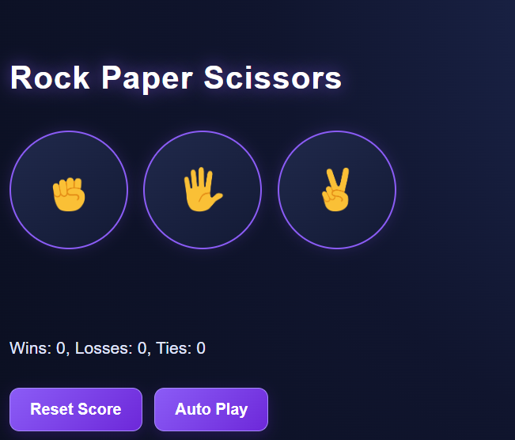

✊ Rock Paper Scissors
## 📸 Game Screenshot

A simple and interactive Rock Paper Scissors game built with HTML, CSS, and JavaScript.

🌐 Live Demo

"Play the Game" ( https://adosh1975musa-hub.github.io/rock-paper-scissors/ )

📌 About the Project

This project is a browser-based version of the classic Rock Paper Scissors game. Players can choose Rock, Paper, or Scissors and compete against the computer.

The project was created as part of my journey in learning JavaScript and front-end web development.

✨ Features

- 🎮 Play against the computer.
- 🏆 Displays the result of each round.
- 📊 Keeps track of wins, losses, and ties.
- 🤖 Auto Play mode.
- 🔄 Reset Score functionality.
- 📱 Simple and responsive-friendly interface.

 Technologies Used

- HTML5 — Page structure.
- CSS3 — Styling and layout.
- JavaScript — Game logic and interactivity.

🚀 How to Play

1. Open the "Live Demo" (https://adosh1975musa-hub.github.io/rock-paper-scissors/).
2. Choose Rock, Paper, or Scissors.
3. The computer randomly selects its move.
4. The game displays the result and updates the score.
5. Use Auto Play to play automatically or Reset Score to restart the score.

📂 Project Structure

rock-paper-scissors/
├── index.html
├── rock-emoji.png
├── paper-emoji.png
├── scissors-emoji.png
├── styles/
│   └── 12-rock-paper-scissors.css
└── scripts/
    └── 12-rock-paper-scissors.js

📚 What I Learned

- Writing JavaScript functions and event handlers.
- Working with the DOM.
- Using CSS to style buttons and images.
- Implementing conditional logic and random computer moves.
- Updating the score dynamically.
- Publishing a website using GitHub Pages.

👨‍💻 Author

Musa

- GitHub: "@adosh1975musa-hub" (https://github.com/adosh1975musa-hub)

---

⭐ If you find this project interesting, feel free to explore the code and try the game!
